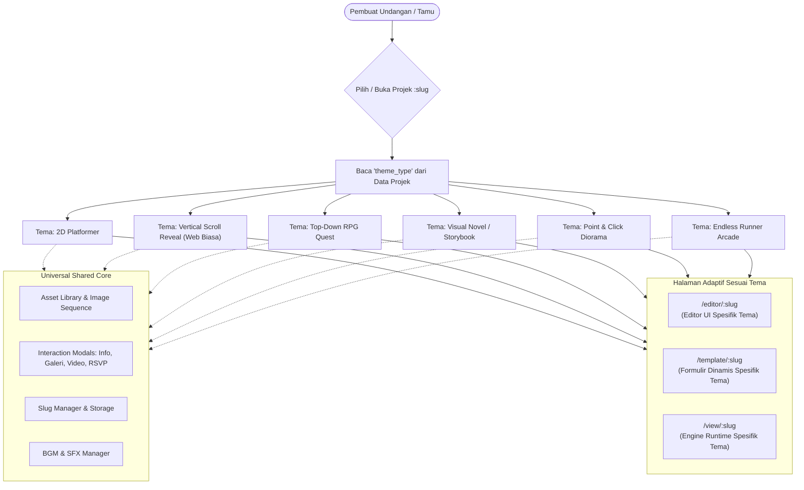
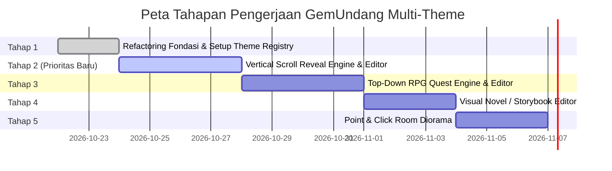

# GemUndang — Perencanaan Arsitektur Multi-Theme Game & Animation Editor

Dokumen perencanaan dan peta jalan arsitektur untuk mentransformasikan **GemUndang** menjadi platform pembuatan website undangan dengan **banyak pilihan tema game dan editor yang adaptif**.

---

## 1. Visi & Tujuan Arsitektur (Multi-Engine Platform)

GemUndang dirancang sebagai **Modular Multi-Theme Engine**, di mana pengguna dapat memilih jenis tampilan dan gameplay yang diinginkan saat membuat undangan baru:



---

## 2. Katalog Tema & Karakteristik Editor

| Kode Tema | Nama Tema | Karakteristik Gameplay / Tampilan | Fitur Khusus pada Editornya |
| :--- | :--- | :--- | :--- |
| `platformer` *(Selesai)* | **2D Platformer Adventure** | Berjalan, melompat di atas platform, menghindari jurang | Painter ground (endless vs platform), parallax layer speed, toggle `canJump` |
| `vertical_scroll` *(Prioritas Baru)* | **Vertical Scroll Reveal (Web Biasa)** | Halaman bertingkat ke bawah (scrollytelling) dengan animasi layer kaya | Page Manager (+Page ke bawah), Layer Order (Z-index), 3-State Animations (Entry, Idle, Exit), Timing & Trigger Manager |
| `topdown_rpg` | **Top-Down Pixel Quest** (Zelda / Pokemon Style) | Karakter bergerak 4/8 arah di overworld/desa/kastil | Tilemap grid painter (jalan, rumput, dinding, sungai), spawn NPC 4 arah, quest gate |
| `visual_novel` | **Romantic Storybook / Visual Novel** | Dialog naratif berlayar penuh, pilihan cerita, potret karakter kiri-kanan | Node / Tree Graph Editor (alur dialog, ekspresi karakter, percabangan cerita cinta) |
| `point_and_click` | **Room Escape / Interactive Diorama** | Mengklik objek di dalam ruangan (meja, bingkai foto, TV, buku tamu) | Hotspot placement editor, zoom-in inspection, layer dekorasi interior |
| `endless_runner` | **Arcade Love Runner** (Flappy / Subway Style) | Karakter lari otomatis, menghindari rintangan, mengumpulkan cincin/hati | Timeline spawner rintangan, kecepatan scroll, milestone jarak untuk memunculkan undangan |
| `isometric` | **Isometric Voxel / Cute Diorama** | Sudut pandang 2.5D isometrik dengan miniatur venue pesta | Isometric grid placement, tinggi elevasi blok (Z-axis), rotasi kamera 90° |

---

## 3. Detail Rencana Editor & Engine Tiap Tema

### A. Tema: Vertical Scroll Reveal / Web Biasa (`vertical_scroll`) — *Prioritas Utama*
- **Konsep**: Tampilan undangan berformat web vertikal modern yang di-scroll ke bawah layaknya website undangan elegan, namun diperkaya dengan animasi visual berlapis (layering), animasi masuk, animasi mengambang (idle), dan animasi keluar dengan kontrol timing dan scroll-trigger.
- **Fitur Editor Khusus**:
  1. **Page Section Manager (Halaman Bertingkat ke Bawah)**:
     - Menambah halaman baru ke bawah (`+ Tambah Halaman`).
     - Mengubah urutan halaman (Drag to reorder / Move Up & Down).
     - Pengaturan latar belakang per halaman: Warna solid, gradient, background image (cover/contain/repeat), atau background parallax effect.
     - Pengaturan tinggi halaman: Fullscreen (`100vh`), auto content, atau fixed pixel.
  2. **Layer Order & Visual Positioning (Z-Index Manager)**:
     - Menempatkan elemen gambar, sprite dari Asset Library, teks judul, tombol, dan ornamen bunga/dekorasi.
     - Posisi bebas atau grid snap di dalam halaman.
     - Panel Layer List: Drag-and-drop urutan tumpukan layer (Bring to Front, Send to Back).
  3. **3-State Animation System**:
     - **Animasi Masuk (Entry Animation)**:
       - Tipe: `fade-in`, `slide-up`, `slide-down`, `slide-left`, `slide-right`, `zoom-in`, `bounce-in`, `flip-in`, `rotate-in`.
     - **Animasi Diam (Idle Animation)**:
       - Tipe: `float` (mengambang naik-turun halus), `pulse` (denyut lembut), `shimmer` (efek kilau emas/cahaya), `breathing`, `sway` (goyangan angin lembut), `slow-spin`.
     - **Animasi Keluar (Exit Animation)**:
       - Tipe: `fade-out`, `slide-out-up`, `slide-out-down`, `zoom-out`, `blur-out`.
  4. **Timing & Trigger Control Engine**:
     - **Opsi Trigger**:
       - `scroll_reveal`: Animasi aktif saat page/elemen mulai terlihat di layar saat di-scroll (dengan threshold & offset yang bisa diatur).
       - `timer`: Animasi aktif otomatis berdasarkan delay detik/milidetik setelah halaman dibuka.
       - `click_tap`: Animasi aktif saat elemen disentuh/diklik tamu.
     - **Kontrol Parameter**:
       - `duration`: Durasi animasi (detik).
       - `delay`: Waktu jeda sebelum animasi mulai (detik).
       - `easing`: `linear`, `ease-in`, `ease-out`, `ease-in-out`, `spring-bouncy`.
       - `repeat`: Sekali saja atau berulang (infinite).
  5. **Granular Editable Flags di Mode Template**:
     - Setiap elemen gambar/teks di dalam page bisa ditandai `editable_appearance` (ganti foto/gambar) dan `editable_content` (ganti teks judul/isi).
  6. **Interactive Popups**:
     - Elemen di halaman bisa diklik untuk memunculkan Video Player Modal, Fullscreen Lightbox Foto, Info Lokasi Maps, atau Form RSVP dengan konfeti.

---

### B. Tema: Top-Down RPG Quest (`topdown_rpg`)
- **Konsep**: Tamu memainkan karakter yang menjelajahi desa pernikahan atau peta fantasi mencari venue acara.
- **Fitur Editor Khusus**:
  1. *Tilemap Painter*: Kuas cat 16x16 atau 32x32 pixel untuk lantai (rumput, bebatuan, karpet merah, kolam, tembok).
  2. *Collision Layer*: Menandai petak yang bisa dilalui (*walkable*) dan solid (*blocked*).
  3. *NPC Patrol / Idle Path*: Menentukan apakah NPC diam atau patroli bolak-balik.
  4. *Quest Trigger*: Syarat membuka gerbang acara (misal: harus bicara dengan NPC penghulu terlebih dahulu).

---

### C. Tema: Visual Novel / Storybook (`visual_novel`)
- **Konsep**: Sangat ideal untuk menceritakan kisah awal mula perkenalan pasangan hingga pernikahan dengan tampilan sinematik berlayar penuh.
- **Fitur Editor Khusus**:
  1. *Scene & Node Flowchart Editor*: Kanvas node untuk mengatur alur percakapan (Bab 1 ➔ Bab 2 ➔ Bab 3).
  2. *Character Expression Staging*: Menempatkan gambar ekspresi karakter di sisi kiri/kanan layar.
  3. *Background Backdrop Switcher*: Mengganti latar belakang per scene.

---

### D. Tema: Point & Click Room Diorama (`point_and_click`)
- **Konsep**: Tamu disajikan ilustrasi ruangan resepsi atau kamar kenangan dan mengklik benda untuk membuka rahasia.
- **Fitur Editor Khusus**:
  1. *Hotspot Boundary Drawer*: Menandai area klik pada ilustrasi latar ruangan.
  2. *Cursor Feedback*: Mengatur bentuk kursor saat mouse melayang di atas objek.
  3. *Unlockable Sequence*: Urutan pembukaan objek interaktif.

---

### E. Tema: Arcade Endless Runner (`endless_runner`)
- **Konsep**: Tamu bermain mini-game lari santai mengumpulkan bunga/cincin dengan jarak tempuh sebagai syarat membuka rincian acara.
- **Fitur Editor Khusus**:
  1. *Obstacle Pattern Designer*: Mengatur pola rintangan yang muncul.
  2. *Difficulty Slider*: Kecepatan lari dan toleransi tabrakan.
  3. *Victory Threshold*: Jarak tempuh kemenangan.

---

## 4. Desain Struktur Data Polymorphic (TypeScript)

```typescript
export type GameThemeType = 
  | 'platformer' 
  | 'vertical_scroll' 
  | 'topdown_rpg' 
  | 'visual_novel' 
  | 'point_and_click' 
  | 'endless_runner';

// Base Interface Universal
export interface BaseProject {
  slug: string;
  title: string;
  subtitle?: string;
  theme_type: GameThemeType;
  is_template_enabled: boolean;
  musicUrl?: string;
  rsvps?: RSVPRecord[];
}

// -------------------------------------------------------------
// SKEMA TEMA VERTICAL SCROLL REVEAL (WEB BIASA)
// -------------------------------------------------------------
export type TriggerType = 'scroll_reveal' | 'timer' | 'click_tap';
export type EntryAnimationType = 'none' | 'fade-in' | 'slide-up' | 'slide-down' | 'slide-left' | 'slide-right' | 'zoom-in' | 'bounce-in';
export type IdleAnimationType = 'none' | 'float' | 'pulse' | 'shimmer' | 'breathing' | 'sway';
export type ExitAnimationType = 'none' | 'fade-out' | 'slide-down' | 'zoom-out' | 'blur-out';

export interface LayerAnimationConfig {
  entry: {
    type: EntryAnimationType;
    duration: number; // detik
    delay: number;    // detik
    easing: string;
    trigger: TriggerType;
  };
  idle: {
    type: IdleAnimationType;
    duration: number; // kecepatan loop (detik)
  };
  exit?: {
    type: ExitAnimationType;
    duration: number;
    delay: number;
    trigger: TriggerType;
  };
}

export interface PageLayerElement {
  id: string;
  name: string;
  type: 'image' | 'text' | 'button' | 'interactive_widget';
  x: number;          // Posisi persentase atau pixel
  y: number;
  width: number;
  height: number;
  zIndex: number;     // Urutan tumpukan layer
  content?: string;   // Teks jika type === 'text'
  mediaUrl?: string;  // Gambar/video jika type === 'image'
  spriteAssetId?: string; // Jika diambil dari Asset Library (termasuk image sequence)
  styleOptions?: {
    fontSize?: number;
    color?: string;
    fontFamily?: string;
    borderRadius?: number;
    shadow?: string;
  };
  animation: LayerAnimationConfig;
  
  // Interaksi saat diklik
  interaction?: {
    type: 'info' | 'image' | 'video' | 'rsvp' | 'scroll_to_page';
    targetPageId?: string;
    title?: string;
    content?: string;
    mediaUrl?: string;
  };

  // Granular Editable Flags untuk Mode Template
  editable_appearance: boolean;
  appearanceLabel?: string;
  editable_content: boolean;
  contentLabel?: string;
}

export interface PageSection {
  id: string;
  title: string;
  order: number;
  minHeight: string; // contoh: '100vh' atau '800px'
  background: {
    type: 'color' | 'gradient' | 'image';
    value: string;
    parallaxSpeed?: number;
    overlayOpacity?: number;
  };
  elements: PageLayerElement[];
}

export interface VerticalScrollProject extends BaseProject {
  theme_type: 'vertical_scroll';
  pages: PageSection[];
  globalTheme: {
    fontFamily: string;
    primaryColor: string;
    accentColor: string;
    showScrollIndicator: boolean;
  };
}

// -------------------------------------------------------------
// UNION PROJECT UNIVERSAL
// -------------------------------------------------------------
export type AnyGemUndangProject = 
  | PlatformerProject 
  | VerticalScrollProject 
  | TopDownRPGProject 
  | VisualNovelProject;
```

---

## 5. Peta Tahapan Pengerjaan (Roadmap)



### Tahap 1: Refactoring Fondasi & Setup Theme Registry
- [x] Engine 2D Platformer & Sprite Sequence Renderer.
- [ ] Memisahkan tipe data projek ke dalam `src/types/` modular (`base.ts`, `platformer.ts`, `verticalScroll.ts`, dll).
- [ ] Membuat struktur Theme Registry (`src/themes/registry.ts`).
- [ ] Memperbarui Dashboard `/` agar pengguna dapat memilih tema saat membuat projek baru.

### Tahap 2 (Baru & Prioritas): Implementasi Tema Vertical Scroll Reveal (Web Biasa)
- [ ] **Runtime Renderer**:
  - Halaman scroll vertikal yang mulus (smooth scrolling).
  - IntersectionObserver trigger untuk memicu animasi masuk & keluar saat page masuk/keluar viewport.
  - CSS keyframes & dynamic styling untuk 3-state animasi (`entry`, `idle`, `exit`).
  - Integrasi popup interaksi (Video, Foto Lightbox, Info, RSVP konfeti).
- [ ] **Level Editor Khusus Vertical Scroll**:
  - Panel Page Manager (Tambah Halaman ke Bawah, Geser urutan page, duplikasi page, hapus page).
  - Visual Page Canvas: Penataan posisi elemen layer gambar/teks secara visual.
  - Layer Manager Panel: Mengatur urutan z-index, hide/show, lock layer.
  - Animation Inspector: Mengatur tipe animasi masuk, idle, dan keluar, lengkap dengan slider duration, delay, easing, dan pemicu (trigger / timer).
  - Instant Playtest Mode: Toggle coba scroll langsung di editor.
- [ ] **Form Template Dinamis**:
  - Otomatis memindai elemen di seluruh page yang berstatus `editable_appearance` (ganti foto/gambar) dan `editable_content` (ganti teks).
  - Live side-by-side preview scrollytelling.

### Tahap 3: Implementasi Tema Top-Down RPG Quest
- [ ] Canvas Tilemap Engine (rendering grid tile & collision system).
- [ ] Level Editor Top-Down: Tile Palette Selector, Brush tool, Eraser tool, Collision toggle.
- [ ] Kontrol pergerakan 4 arah (WASD / Mobile D-Pad) dengan sprite arah.
- [ ] Proximity interaksi NPC dan editable flags.

### Tahap 4: Implementasi Tema Visual Novel / Storybook
- [ ] Node Flow / Scene Graph Editor untuk percakapan dialog.
- [ ] UI pembaca visual novel (typewriter text effect, ekspresi karakter kiri-kanan, pemilih opsi cabang dialog).

### Tahap 5: Implementasi Tema Point & Click / Room Diorama
- [ ] Editor penempatan Hotspot interaktif pada ilustrasi denah/ruangan.
- [ ] Interaksi klik membuka popup kartu undangan, video projector, atau meja buku tamu.

---

## 6. Keuntungan Arsitektur Ini
1. **Pilihan Sangat Luas untuk Pengguna**: Pengguna yang ingin undangan interaktif santai layaknya website biasa bisa memilih **Vertical Scroll Reveal**, sedangkan yang ingin sensasi game penuh petualangan bisa memilih **Platformer** atau **Top-Down RPG**.
2. **Editor Sesuai Konteks**: Mode website biasa membutuhkan editor berbasis seksi halaman ke bawah dan layer animasi, bukan editor fisika gravitasi lompatan platformer. Masing-masing tema memiliki editor yang paling cocok dan mudah digunakan.
3. **Pustaka Aset Terbagi Bersama**: Semua gambar, sprite, dan musik di Asset Library bisa dipakai silang di tema manapun.
