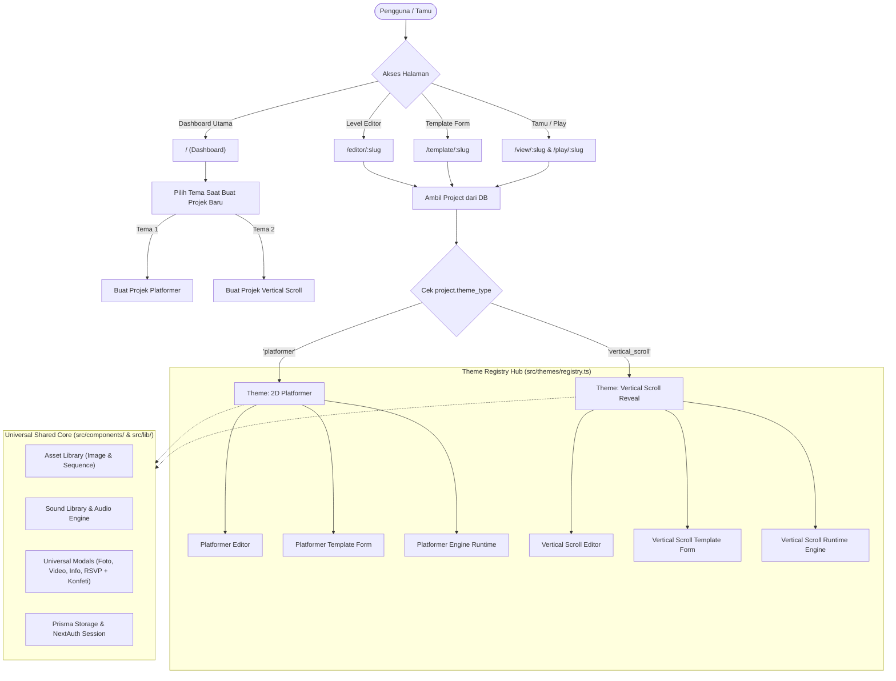

# Perencanaan Implementasi Multi-Theme Editor (Tahap 1 & Tahap 2)
**Platform: GemUndang**  
**Fokus: Fondasi Theme Registry & Engine Vertical Scroll Reveal**

---

## 1. Latar Belakang & Analisis Kondisi Eksisting

### 1.1 Kondisi Codebase Saat Ini
Codebase GemUndang telah dilengkapi beberapa pembaruan terkini:
1. **Autentikasi & Database**:
   - Menggunakan **NextAuth v5** (`auth.ts`, session-based, bcrypt password hash).
   - Menggunakan **Prisma ORM** dengan database MySQL (`prisma/schema.prisma`).
   - Tabel `Project` menyimpan kolom `slug`, `title`, `subtitle`, `isTemplateEnabled`, `isTemplate`, `visibility`, `ownerId`, dan kolom `data` (`Json`).
   - Hubungan relasi `Project` ➔ `Rsvp` (One-to-Many).
2. **Platformer Engine & Assets**:
   - Engine 2D Platformer lengkap dengan kustomisasi hitbox (`PlayerColliderConfig`), orientasi, dan audio engine terintegrasi (`SoundLibraryModal`, `AssetLibraryModal`).
   - Tipe data saat ini terpusat di `src/types/platformer.ts` dan di-hardcode di `projectStorage.ts` mengasumsikan semua project bertipe platformer.

### 1.2 Prinsip Utama Refactoring
- **Zero Breaking Changes / Backward Compatibility**: Project platformer yang sudah tersimpan di database harus tetap bisa dibuka, diedit, dan dimainkan tanpa error.
- **Polymorphic Data Storage**: Menjaga fleksibilitas kolom `data` (Json) di Prisma dengan menambahkan atribut pembeda tema: `theme_type: 'platformer' | 'vertical_scroll'`. Jika `data.theme_type` tidak ada / undefined, sistem otomatis menanganinya sebagai `'platformer'`.
- **Modular Theme Separation**: Memisahkan komponen editor, template form, dan engine runtime ke dalam modul tema independen (`src/themes/[theme-name]/`) dengan shared universal core.

---

## 2. Arsitektur Multi-Theme (Registry Pattern)

### 2.1 Diagram Alur Sistem


---

## 3. Rencana Eksekusi Tahap 1: Refactoring Fondasi & Setup Theme Registry

Tahap 1 berfokus pada pembangunan fondasi polymorphic dan registry tanpa merusak engine platformer yang sudah ada.

### 3.1 Pemisahan dan Modularisasi Tipe Data (`src/types/`)
1. **`src/types/base.ts` [NEW]**:
   - Mendefinisikan tipe dasar yang dimiliki oleh semua jenis project:
     ```typescript
     export type GameThemeType = 'platformer' | 'vertical_scroll';

     export interface BaseProject {
       slug: string;
       title: string;
       subtitle?: string;
       theme_type: GameThemeType;
       is_template_enabled: boolean;
       musicUrl?: string;
       rsvps?: RSVPRecord[];
       createdAt?: string;
       updatedAt?: string;
     }
     ```
   - Memindahkan `RSVPRecord`, `SpriteAsset`, `SpriteType`, `SoundAsset`, `SoundEventType` yang bersifat universal ke `base.ts`.
2. **`src/types/platformer.ts` [MODIFY]**:
   - Menjadikan `PlatformerProject extends BaseProject` dengan `theme_type: 'platformer'`.
3. **`src/types/verticalScroll.ts` [NEW]**:
   - Mendefinisikan skema data untuk tema Vertical Scroll Reveal (dijelaskan pada Tahap 2).
4. **`src/types/index.ts` [NEW]**:
   - Mengeskpor union type:
     ```typescript
     export type AnyGemUndangProject = PlatformerProject | VerticalScrollProject;
     ```

### 3.2 Pembuatan Theme Registry Hub (`src/themes/`)
1. **`src/themes/types.ts` [NEW]**:
   - Mendefinisikan kontrak interface `ThemeDefinition<T>`:
     ```typescript
     export interface ThemeDefinition<T extends BaseProject = any> {
       id: GameThemeType;
       name: string;
       description: string;
       badge: string;
       icon: LucideIcon;
       defaultProject: (slug: string, title: string) => T;
       EditorComponent: React.ComponentType<{ project: T; onSave: (updated: T) => Promise<boolean> }>;
       TemplateComponent: React.ComponentType<{ project: T; onSave: (updated: T) => Promise<boolean> }>;
       RuntimeComponent: React.ComponentType<{ project: T; mode: 'play' | 'test' | 'preview'; guestName?: string }>;
     }
     ```
2. **`src/themes/registry.ts` [NEW]**:
   - Menyediakan objek dictionary:
     ```typescript
     export const THEME_REGISTRY: Record<GameThemeType, ThemeDefinition<any>> = {
       platformer: PlatformerThemeDefinition,
       vertical_scroll: VerticalScrollThemeDefinition,
     };

     export function getThemeDefinition(themeType?: string): ThemeDefinition {
       if (themeType && themeType in THEME_REGISTRY) {
         return THEME_REGISTRY[themeType as GameThemeType];
       }
       return THEME_REGISTRY.platformer; // Default fallback aman
     }
     ```
3. **Migrasi Tema Platformer ke Modul Tema**:
   - Pindahkan / bungkus `PlatformerEngine`, level editor platformer, dan template customizer platformer ke dalam `src/themes/platformer/`.

### 3.3 Penyesuaian `projectStorage.ts` & Database
1. **Fallback Aman pada `toProject`**:
   - Saat membaca baris tabel `Project` dari Prisma:
     ```typescript
     const themeType: GameThemeType = (data as any)?.theme_type || 'platformer';
     ```
   - Dengan pendekatan ini, seluruh project lama yang ada di MySQL otomatis dikenali sebagai `'platformer'` tanpa perlu migrasi paksa.
2. **Pembaruan `createNewProject`**:
   - Menambahkan parameter opsi `theme_type?: GameThemeType` (default `'platformer'`).
   - Mengambil template default dari `THEME_REGISTRY[theme_type].defaultProject(slug, title)`.
3. **Pembaruan `ProjectSummary`**:
   - Menambahkan field `theme_type: GameThemeType` agar Dashboard dapat menampilkan ikon dan badge tema yang tepat.

### 3.4 Pembaruan Dashboard (`src/app/page.tsx`)
1. **Selector Tema Game saat Pembuatan Projek**:
   - Menampilkan kartu pilihan tema interaktif:
     - **Tema 1: 2D Platformer Quest** (Ikon Gamepad, badge "Game 2D").
     - **Tema 2: Vertical Scroll Reveal** (Ikon LayoutTemplate / Scroll, badge "Web Interaktif").
2. **Tampilan List Projek & Template**:
   - Menampilkan badge tema (`Game 2D` atau `Web Scroll`) pada masing-masing card.
   - Tombol Editor, Template, dan View tetap bekerja transparan karena diarahkan sesuai tema via dynamic page switcher.

---

## 4. Rencana Eksekusi Tahap 2: Implementasi Tema Vertical Scroll Reveal

Tema ini dirancang untuk pengguna yang menginginkan format website undangan elegan yang di-scroll ke bawah layaknya website modern, namun sarat animasi visual multi-layer yang dinamis.

### 4.1 Desain Struktur Data `VerticalScrollProject`
File: `src/types/verticalScroll.ts`

```typescript
export type TriggerType = 'scroll_reveal' | 'timer' | 'click_tap';

export type EntryAnimationType = 
  | 'none'
  | 'fade-in'
  | 'slide-up'
  | 'slide-down'
  | 'slide-left'
  | 'slide-right'
  | 'zoom-in'
  | 'bounce-in'
  | 'flip-in';

export type IdleAnimationType = 
  | 'none'
  | 'float'
  | 'pulse'
  | 'shimmer'
  | 'breathing'
  | 'sway';

export type ExitAnimationType = 
  | 'none'
  | 'fade-out'
  | 'slide-down'
  | 'slide-up'
  | 'zoom-out'
  | 'blur-out';

export interface LayerAnimationConfig {
  entry: {
    type: EntryAnimationType;
    duration: number; // detik (default: 0.8)
    delay: number;    // detik jeda (default: 0.2)
    easing: 'linear' | 'ease-out' | 'ease-in-out' | 'spring' | 'bounce';
    trigger: TriggerType; // 'scroll_reveal' | 'timer' | 'click_tap'
  };
  idle: {
    type: IdleAnimationType;
    duration: number; // kecepatan loop (detik)
  };
  exit?: {
    type: ExitAnimationType;
    duration: number;
    delay: number;
    trigger: TriggerType;
  };
}

export interface PageLayerElement {
  id: string;
  name: string;
  type: 'image' | 'text' | 'button' | 'interactive_widget';
  x: number;          // Posisi persentase (0-100%) atau pixel
  y: number;          // Posisi persentase atau pixel
  width: number;
  height: number;
  zIndex: number;     // Urutan tumpukan layer (Z-index)
  content?: string;   // Teks jika type === 'text'
  mediaUrl?: string;  // URL gambar jika type === 'image'
  spriteAsset?: SpriteAsset; // Gambar tunggal atau image sequence dari Asset Library
  styleOptions?: {
    fontSize?: number;
    fontWeight?: string;
    color?: string;
    textAlign?: 'left' | 'center' | 'right';
    borderRadius?: number;
    shadow?: string;
    opacity?: number;
  };
  animation: LayerAnimationConfig;

  // Interaksi universal saat diklik / disentuh
  hasInteraction: boolean;
  interaction?: {
    type: 'info' | 'image' | 'video' | 'rsvp' | 'scroll_to_page';
    targetPageId?: string;
    title?: string;
    content?: string;
    mediaUrl?: string;
    actionButtonText?: string;
    actionUrl?: string;
  };

  // Granular Editable Flags untuk Mode Template
  editable_appearance: boolean; // Boleh ganti foto/gambar di mode template
  appearanceLabel?: string;     // Contoh: "Foto Utama Cover"
  editable_content: boolean;    // Boleh ganti teks judul/isi di mode template
  contentLabel?: string;        // Contoh: "Nama Pasangan Pengantin"
}

export interface PageSection {
  id: string;
  title: string;
  order: number;
  minHeight: string; // '100vh', '800px', 'auto'
  background: {
    type: 'color' | 'gradient' | 'image';
    value: string; // Hex color, CSS gradient, atau Image URL
    parallaxSpeed?: number; // 0 = statis, 0.5 = parallax pelan
    overlayOpacity?: number;
  };
  elements: PageLayerElement[];
}

export interface VerticalScrollProject extends BaseProject {
  theme_type: 'vertical_scroll';
  pages: PageSection[];
  globalTheme: {
    fontFamily: string;
    primaryColor: string;
    accentColor: string;
    showScrollIndicator: boolean;
    smoothScroll: boolean;
  };
}
```

---

### 4.2 Komponen Runtime Vertical Scroll (`src/themes/vertical-scroll/runtime/`)
1. **Dynamic Animation Engine & CSS Generator**:
   - Memetakan konfigurasi animasi (`entry`, `idle`, `exit`) ke class animasi Tailwind / CSS Keyframes atau inline styling.
   - Mendukung animasi idle berulang:
     - `float`: translasi sumbu Y `sin()` mengambang lembut.
     - `pulse`: skala denyut nafas lembut (1.0 ➔ 1.05 ➔ 1.0).
     - `shimmer`: pantulan cahaya emas/putih bergerak melintang.
     - `sway`: rotasi derajat kecil (-3deg hingga +3deg) seperti ditiup angin.
2. **Scroll Trigger dengan `IntersectionObserver`**:
   - Setiap page/elemen diamati saat masuk atau keluar viewport (threshold 0.15 - 0.5).
   - Saat masuk viewport: memicu transisi `entry`, dilanjutkan looping `idle`.
   - Saat keluar viewport: memicu transisi `exit`.
3. **Timer & Click Trigger**:
   - Pilihan pemicu berbasis waktu otomatis (`timer` dengan delay ms/s) atau saat disentuh (`click_tap`).
4. **Integrasi Universal Interaction Modals**:
   - Menggunakan komponen modal yang sudah ada untuk Video Player, Lightbox Foto Fullscreen, Tautan Google Maps, dan Form RSVP dengan selebrasi konfeti.

---

### 4.3 Visual Level Editor Vertical Scroll (`src/themes/vertical-scroll/editor/`)
1. **Page Section Manager (Manajer Halaman ke Bawah)**:
   - Panel sidebar / floating bar untuk mengelola daftar halaman:
     - Tombol `+ Tambah Halaman` ke bawah.
     - Drag reorder urutan halaman (Page 1: Cover ➔ Page 2: Profil ➔ Page 3: Acara & Rundown ➔ Page 4: Galeri ➔ Page 5: RSVP).
     - Tombol Duplikat Halaman, Ganti Nama Halaman, dan Hapus Halaman.
     - Pengaturan latar belakang per halaman: Color Picker, Gradient Picker, Image Uploader, dan toggle Parallax Background.
2. **Canvas Visual & Layer Ordering (Z-Index Manager)**:
   - Canvas vertikal yang dapat di-scroll saat mendesain.
   - Transform Handles: Klik elemen untuk menggeser posisi X/Y, memperbesar/memperkecil ukuran width/height.
   - **Layer Panel**:
     - Menampilkan urutan tumpukan layer elemen pada halaman yang aktif.
     - Drag-and-drop urutan layer.
     - Tombol aksi cepat: *Bring to Front* (Paling Depan) & *Send to Back* (Paling Belakang).
     - Toggle visibility (Sembunyikan/Tampilkan) dan Lock posisi.
3. **3-State Animation & Timing Inspector Panel**:
   - **Tab Entry Animation**: Dropdown tipe animasi masuk, slider durasi (0.1s - 5s), slider delay (0s - 3s), pilihan easing kurva, pilihan trigger (`scroll_reveal`, `timer`, `click`).
   - **Tab Idle Animation**: Dropdown tipe animasi diam (`none`, `float`, `pulse`, `shimmer`, `sway`), slider kecepatan durasi loop.
   - **Tab Exit Animation**: Dropdown tipe animasi keluar saat halaman di-scroll melewatinya.
4. **Granular Editable Flags Inspector**:
   - Checkbox `editable_appearance`: mengizinkan pemakai template mengganti foto/gambar di form template.
   - Checkbox `editable_content`: mengizinkan pemakai template mengganti teks judul/isi di form template.
   - Input custom label untuk formulir template.
5. **Instant Test Play Mode (Test Scroll)**:
   - Tombol toggle `Play / Test Mode` di toolbar atas editor.
   - Saat aktif, canvas beralih ke preview interaktif tamu sehingga desainer dapat langsung mencoba men-scroll ke bawah dan merasakan respon animasi secara real-time.

---

### 4.4 Form Template Dinamis (`src/themes/vertical-scroll/template/`)
1. **Dynamic Section Accordion Form**:
   - Memindai seluruh `pages` dan hanya merender field untuk elemen yang memiliki flag `editable_appearance` atau `editable_content`.
   - Mengelompokkan input berdasarkan nama Halaman (misal: "Seksi 1: Halaman Pembuka", "Seksi 2: Rincian Acara").
2. **Live Side-by-Side Reactive Preview**:
   - Sisi Kiri: Form input sederhana (ganti foto, ganti teks nama, tanggal, lokasi).
   - Sisi Kanan: Viewport website vertikal yang langsung ter-update seketika (reactive) saat teks diketik atau foto diganti.

---

## 5. Ringkasan File yang Dimodifikasi & Dibuat

### File Baru yang Dibuat:
| Lokasi File | Fungsi |
| :--- | :--- |
| `src/types/base.ts` | Base interfaces (`BaseProject`, `RSVPRecord`, `SpriteAsset`, dsb) |
| `src/types/verticalScroll.ts` | Schema tipe lengkap tema Vertical Scroll Reveal |
| `src/types/index.ts` | Re-export union `AnyGemUndangProject` |
| `src/themes/types.ts` | Interface kontrak `ThemeDefinition` |
| `src/themes/registry.ts` | Hub registrasi tema (`THEME_REGISTRY`) dan resolver |
| `src/themes/platformer/` | Folder isolasi komponen editor, template, dan runtime tema Platformer |
| `src/themes/vertical-scroll/runtime/VerticalScrollEngine.tsx` | Engine runtime rendering halaman vertikal beranimasi |
| `src/themes/vertical-scroll/runtime/animations.ts` | Generator keyframes & CSS classes untuk 3-state animations |
| `src/themes/vertical-scroll/editor/VerticalScrollEditor.tsx` | UI Level editor khusus halaman bertingkat & layer animation |
| `src/themes/vertical-scroll/template/VerticalScrollTemplate.tsx` | Form customizer dinamis + split screen live preview |
| `src/themes/vertical-scroll/defaultProject.ts` | Data demo default tema Vertical Scroll Reveal |

### File yang Dimodifikasi:
| Lokasi File | Perubahan |
| :--- | :--- |
| `src/types/platformer.ts` | Mewarisi `BaseProject` dari `src/types/base.ts` |
| `src/lib/projectStorage.ts` | Menggunakan resolver polymorphic `theme_type`, mendukung `VerticalScrollProject` |
| `src/app/page.tsx` | Menambahkan card selector tema saat pembuatan project baru dan badge tema |
| `src/app/editor/[slug]/page.tsx` | Menggunakan `getThemeDefinition(project.theme_type).EditorComponent` |
| `src/app/template/[slug]/page.tsx`| Menggunakan `getThemeDefinition(project.theme_type).TemplateComponent` |
| `src/app/view/[slug]/page.tsx` | Menggunakan `getThemeDefinition(project.theme_type).RuntimeComponent` |

---

## 6. Rencana Verifikasi & Testing

1. **Uji Regresi Platformer (Backward Compatibility)**:
   - Buka project platformer yang sudah ada di database.
   - Pastikan level editor platformer, template form, dan view game platformer tetap berfungsi 100% normal tanpa error.
2. **Uji Pembuatan Projek Baru**:
   - Buat projek dengan memilih kartu **Tema 1: 2D Platformer** ➔ harus mengarah ke Editor Platformer.
   - Buat projek dengan memilih kartu **Tema 2: Vertical Scroll Reveal** ➔ harus mengarah ke Editor Vertical Scroll.
3. **Uji Editor Vertical Scroll**:
   - Tambah 3 halaman ke bawah (Cover, Acara, RSVP).
   - Atur urutan layer (Z-index), atur animasi masuk (`fade-in`, `slide-up`), animasi idle (`float`, `pulse`), dan timing delay.
   - Nyalakan mode Test Scroll untuk memverifikasi animasi berjalan mulus.
4. **Uji Template Form Vertical Scroll**:
   - Buka `/template/[slug]` untuk projek vertical scroll.
   - Verifikasi hanya elemen bercentang `editable_appearance` dan `editable_content` yang muncul di form.
   - Ubah teks dan gambar, pastikan preview di sisi kanan langsung reaktif berubah.
5. **Uji Build Produksi**:
   - Jalankan `npm run build` dan pastikan proses kompilasi lolos tanpa error TypeScript maupun Turbopack prerender error.
