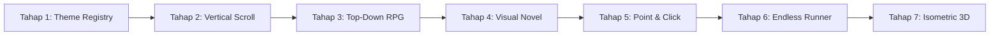

# Perencanaan Teknis: Future Stages Roadmap (Tahap 3 s/d Tahap 7)
**Platform:** GemUndang  
**Fokus:** Pengembangan Tema Game & Interaksi Lanjutan di Masa Depan

---

## 1. Peta Jalan Pengembangan Jangka Panjang

Setelah fondasi Theme Registry (**Tahap 1**) dan tema Vertical Scroll Reveal (**Tahap 2**) selesai, platform GemUndang dapat terus dikembangkan secara modular untuk tema-tema berikut tanpa mengubah struktur core:

---

## 2. Rincian Konsep & Fitur Tiap Tahap Masa Depan

### 🎮 Tahap 3: Top-Down RPG Quest (`topdown_rpg`)
- **Konsep**: Tamu memainkan karakter yang menjelajahi desa pernikahan, taman kastil, atau pulau fantasi dengan sudut pandang dari atas (*top-down*) layaknya game klasik Pokémon / Zelda.
- **Fitur Editor Khusus**:
  1. *Tilemap Painter*: Kuas cat berbasis petak grid 16x16 atau 32x32 pixel untuk menggambar lantai (rumput, bebatuan, karpet merah, kolam air, dinding).
  2. *Collision Mask*: Menandai petak yang dapat dilalui (*walkable*) dan petak terhalang (*blocked/solid*).
  3. *4-Way Character Controller*: Karakter memiliki 4 arah hadap (atas, bawah, kiri, kanan) dengan animasi kaki melangkah.
  4. *Overworld NPC & Quest Gate*: NPC orang tua, bridesmaid, atau pemandu acara yang memberikan petunjuk arah venue. Gerbang pelaminan baru terbuka setelah tamu menyelesaikan dialog tertentu.

---

### 📖 Tahap 4: Romantic Storybook / Visual Novel (`visual_novel`)
- **Konsep**: Format naratif berlayar penuh yang berfokus pada perjalanan cerita cinta pasangan (dari awal bertemu, pacaran, lamaran, hingga hari pernikahan) dengan gaya visual anime / ilustrasi dongeng yang sinematik.
- **Fitur Editor Khusus**:
  1. *Node Flowchart Dialogue Editor*: Kanvas grafik berbasis simpul (*node graph*) untuk mengatur alur percakapan, percabangan pilihan cerita, dan transisi babak.
  2. *Character Expression Staging*: Menempatkan potret karakter di sisi kiri/kanan layar dengan ekspresi emosi yang bisa berganti (senang, terkejut, tersipu, romantis).
  3. *Backdrop Switcher*: Mengganti gambar latar belakang secara dinamis per scene (misal: kafe pertemuan pertama, bioskop kencan, pantai lamaran, gedung resepsi).
  4. *Typewriter Effect & Auto-Play*: Efek teks mengetik otomatis dengan kecepatan yang dapat diatur serta tombol skip / auto-read.

---

### 🔍 Tahap 5: Point & Click Room Diorama (`point_and_click`)
- **Konsep**: Tamu disajikan ilustrasi ruangan resepsi, kamar kenangan, atau meja pernikahan. Tamu dapat mengklik berbagai objek interaktif di dalam ruangan untuk menemukan rahasia dan detail acara.
- **Fitur Editor Khusus**:
  1. *Hotspot Boundary Drawer*: Desainer dapat menggambar area sentuh interaktif (lingkaran, persegi, atau poligon bebas) di atas gambar latar belakang ruangan.
  2. *Interactive Object Trigger*:
     - Klik proyektor / TV ➔ Memutar video prewedding.
     - Klik album foto di meja ➔ Membuka galeri foto kenangan.
     - Klik buku tamu di resepsionis ➔ Membuka formulir RSVP.
     - Klik amplop emas ➔ Membuka surat undangan resmi.
  3. *Visual Inspection Mode*: Zoom-in halus saat suatu objek diklik.

---

### 🏃 Tahap 6: Arcade Love Runner (`endless_runner`)
- **Konsep**: Mini-game kasual santai di mana karakter berlari secara otomatis, melompati rintangan kecil, dan mengumpulkan bunga atau cincin emas diiringi alunan musik pesta ceria.
- **Fitur Editor Khusus**:
  1. *Obstacle Pattern Designer*: Mengatur pola rintangan yang muncul secara berulang.
  2. *Difficulty & Invincible Mode*: Slider kecepatan lari serta opsi mode "kebal/ramah tamu" agar semua tamu dari segala usia dapat menyelesaikan permainan dengan gembira.
  3. *Victory Milestone*: Setelah mencapai jarak tertentu (misal: 1000 meter), karakter tiba di pelaminan dan amplop undangan terbuka dengan selebrasi kembang api dan konfeti.

---

### 🎲 Tahap 7: Isometric 2.5D / Voxel Mini-Venue (`isometric`)
- **Konsep**: Sudut pandang 2.5D isometrik dengan model miniatur venue pesta yang estetik dan imut.
- **Fitur Editor Khusus**:
  1. *Isometric Grid Placement*: Penataan blok elevasi (tinggi Z-axis) dan dekorasi isometrik.
  2. *Camera Orbit*: Rotasi sudut pandang kamera 90 derajat mengelilingi panggung pelaminan.

---

## 3. Strategi Implementasi Masa Depan
Setiap tema baru di atas akan dibuat mengikuti pola **Theme Definition** yang sudah diuji pada Tahap 1 & Tahap 2:
1. Menambahkan tipe tema pada `src/types/base.ts`.
2. Membuat folder `src/themes/[nama_tema]/` berisi `defaultProject.ts`, `Editor.tsx`, `Template.tsx`, dan `Engine.tsx`.
3. Mendaftarkan tema tersebut ke `src/themes/registry.ts`.
4. Sistem otomatis mengenali dan menyediakan tema tersebut di Dashboard dan routing tanpa mengganggu tema yang sudah ada.
