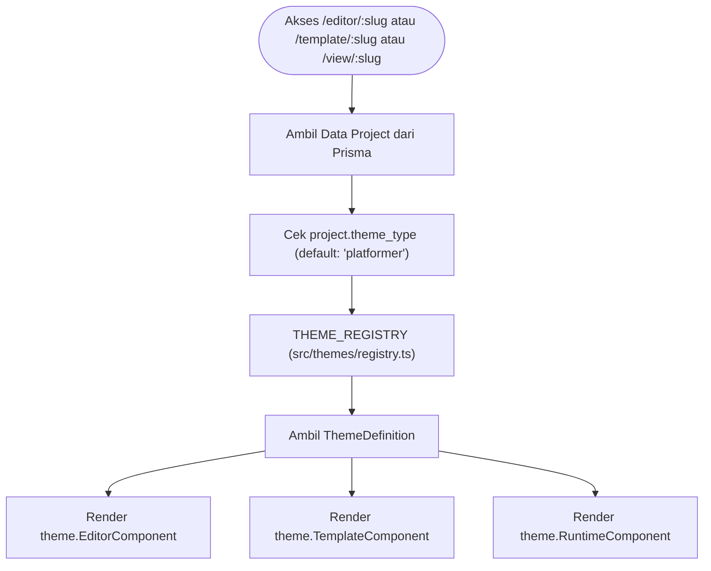

# Perencanaan Teknis: Tahap 1 — Refactoring Fondasi & Setup Theme Registry
**Platform:** GemUndang  
**Fokus:** Fondasi Arsitektur Polymorphic, Theme Registry Pattern, dan Backward Compatibility

---

## 1. Tujuan & Sasaran Tahap 1
1. **Mengubah Arsitektur Single-Theme Menjadi Multi-Theme**:
   - Mentransformasikan sistem GemUndang dari yang sebelumnya terkunci hanya pada 2D Platformer menjadi sistem registry modular yang mampu menampung berbagai jenis tema game dan web undangan.
2. **100% Backward Compatibility**:
   - Seluruh project platformer yang sudah tersimpan di database MySQL (via Prisma ORM) tetap dapat dibuka di editor, dicustomize via template form, dan dimainkan oleh tamu tanpa error.
   - Tidak memerlukan migrasi database destruktif.
3. **Pemisahan Modular Tanpa Kode Duplikat**:
   - Komponen universal (*Asset Library, Sound Library, Audio Engine, Universal Modals: Video, Lightbox Foto, Maps, RSVP*) tetap berada di shared core dan dapat digunakan oleh semua tema.
   - Komponen spesifik tema diisolasi rapi di dalam `src/themes/[theme_name]/`.
4. **Pembaruan Dashboard**:
   - Menyediakan antarmuka pemilihan tema saat pengguna membuat project baru.
   - Menampilkan badge tema pada daftar project dan template di dashboard.

---

## 2. Analisis Kondisi Eksisting & Integrasi
- **Autentikasi**: NextAuth v5 dengan session cookie.
- **Database (Prisma + MySQL)**:
  - Model `Project`: kolom `data` berformat `Json`.
  - Strategi kompatibilitas: Menyimpan `theme_type` di dalam payload JSON `data`.
  - Jika `data.theme_type` kosong/undefined, sistem otomatis memperlakukannya sebagai `'platformer'`.

---

## 3. Desain Arsitektur Theme Registry

### 3.1 Diagram Alur Theme Registry


### 3.2 Definisi Kontrak Interface (`src/themes/types.ts`)
```typescript
import { LucideIcon } from 'lucide-react';
import { BaseProject, GameThemeType } from '@/types/base';

export interface ThemeDefinition<T extends BaseProject = any> {
  id: GameThemeType;
  name: string;
  description: string;
  badge: string;
  icon: LucideIcon;
  defaultProject: (slug: string, title: string) => T;
  EditorComponent: React.ComponentType<{
    project: T;
    onSave: (updated: T) => Promise<boolean>;
  }>;
  TemplateComponent: React.ComponentType<{
    project: T;
    onSave: (updated: T) => Promise<boolean>;
  }>;
  RuntimeComponent: React.ComponentType<{
    project: T;
    mode: 'play' | 'test' | 'preview';
    guestName?: string;
  }>;
}
```

---

## 4. Rincian Perubahan File & Struktur Direktori

### A. Modularisasi Tipe Data (`src/types/`)
- **`src/types/base.ts` [NEW]**:
  - `GameThemeType`: `'platformer' | 'vertical_scroll'` (dan extensible untuk tahap masa depan).
  - `BaseProject`: `slug`, `title`, `subtitle`, `theme_type`, `is_template_enabled`, `musicUrl`, `rsvps`, dll.
  - Universal types: `RSVPRecord`, `SpriteAsset`, `SpriteType`, `SoundAsset`, `SoundEventType`.
- **`src/types/platformer.ts` [MODIFY]**:
  - Ubah `PlatformerProject` menjadi turunan dari `BaseProject` (`theme_type: 'platformer'`).
  - Menjaga seluruh konfigurasi `player`, `collider`, `hitbox`, `world`, `entities`, `audio` tetap utuh.
- **`src/types/index.ts` [NEW]**:
  - Re-export union polymorphic `AnyGemUndangProject`.

### B. Theme Registry Module (`src/themes/`)
- **`src/themes/types.ts` [NEW]**: Interface `ThemeDefinition`.
- **`src/themes/registry.ts` [NEW]**:
  - Objek kamus `THEME_REGISTRY`.
  - Fungsi `getThemeDefinition(themeType?: string): ThemeDefinition` dengan fallback aman ke platformer.
- **`src/themes/platformer/` [NEW / REORGANIZE]**:
  - Membungkus komponen platformer yang sudah ada ke modul tema:
    - `PlatformerEditor.tsx`
    - `PlatformerTemplate.tsx`
    - `PlatformerEngine.tsx`
    - `defaultProject.ts`

### C. Database & Data Storage Adapter (`src/lib/projectStorage.ts`)
- **`toProject(row)`**:
  - Membaca `row.data.theme_type || 'platformer'`.
  - Memetakan data sesuai tipe tema masing-masing.
- **`createNewProject`**:
  - Menerima opsi `theme_type?: GameThemeType`.
  - Mengambil seed default dari `THEME_REGISTRY[theme_type].defaultProject(slug, title)`.
- **`ProjectSummary`**:
  - Menyertakan field `theme_type: GameThemeType` untuk render ikon dan badge di dashboard.

### D. Pembaruan Dashboard (`src/app/page.tsx`)
- Menambahkan **Theme Selector Card** pada formulir pembuatan project baru:
  - Kartu 1: **2D Platformer Quest** (Ikon Gamepad, Badge: "Game 2D").
  - Kartu 2: **Vertical Scroll Reveal** (Ikon LayoutTemplate, Badge: "Web Interaktif").
- Menampilkan badge tema pada daftar project di tab "Projek Saya" dan tab "Template Siap Pakai".

### E. Dynamic Route Switchers
- **`src/app/editor/[slug]/page.tsx` [MODIFY]**:
  - Ambil project dari storage ➔ panggil `getThemeDefinition(project.theme_type).EditorComponent`.
- **`src/app/template/[slug]/page.tsx` [MODIFY]**:
  - Ambil project dari storage ➔ panggil `getThemeDefinition(project.theme_type).TemplateComponent`.
- **`src/app/view/[slug]/page.tsx` [MODIFY]**:
  - Ambil project dari storage ➔ panggil `getThemeDefinition(project.theme_type).RuntimeComponent`.

---

## 5. Rencana Verifikasi Tahap 1
1. **Verifikasi Database**:
   - Membuka project platformer yang dibuat sebelum refactoring.
   - Memastikan tidak ada field yang hilang atau error casting TypeScript.
2. **Verifikasi CRUD**:
   - Buat project baru dengan tema platformer.
   - Simpan perubahan, pastikan data tersimpan di MySQL dan terbaca kembali.
3. **Verifikasi Build**:
   - Jalankan `npm run build` dan pastikan zero error.
